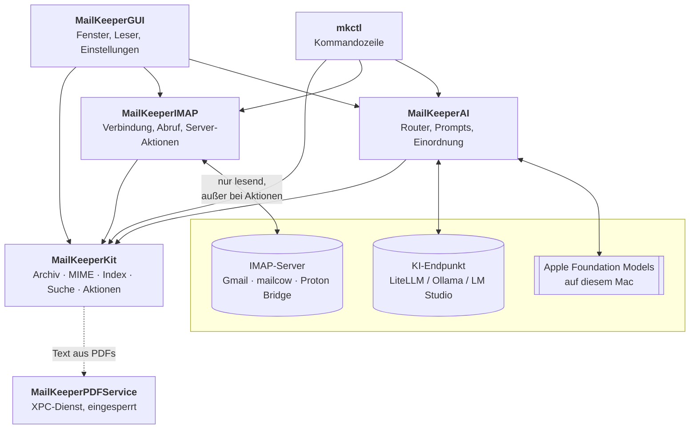
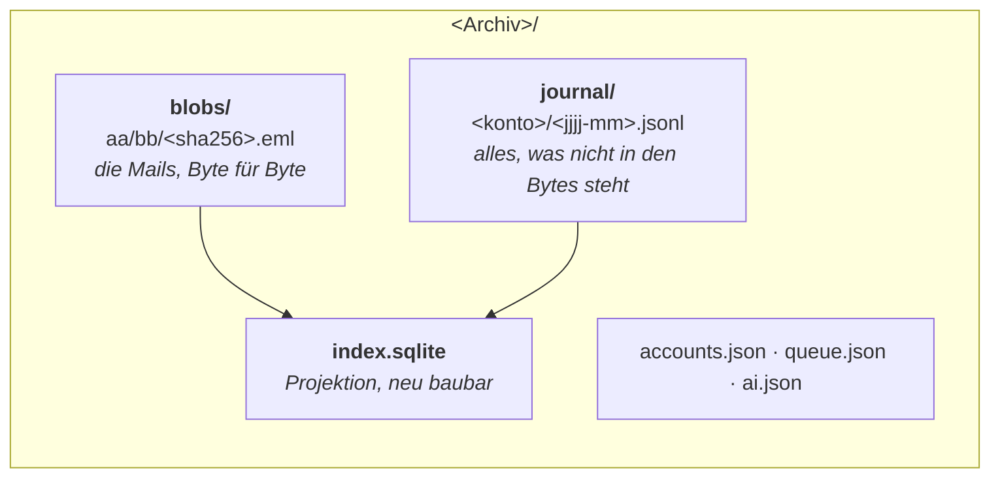
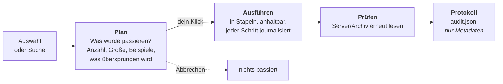
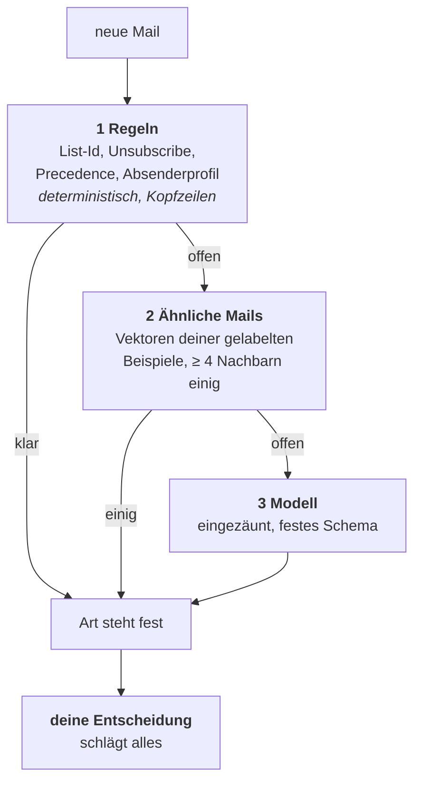
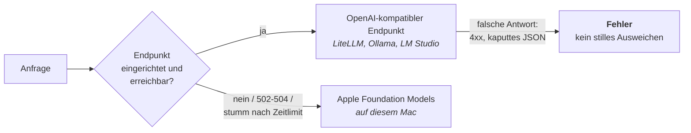
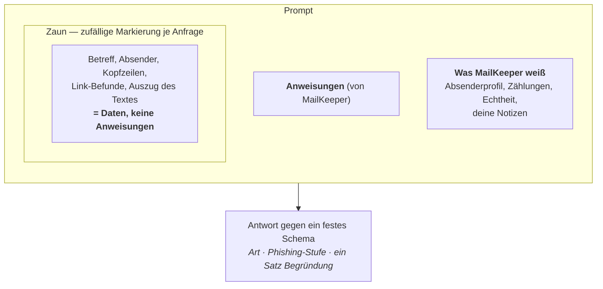

# Wie MailKeeper gebaut ist

Dieser Text erklärt, **was** MailKeeper tut, **wie** es das tut und **warum** es so gebaut ist.
Er richtet sich an alle, die mehr wissen wollen als die Bedienung hergibt — die Entscheidungen
dahinter stehen ausführlich in den [Architekturentscheidungen](adr/) (ADR-0001 bis ADR-0012),
auf die hier verwiesen wird.

Für die Bedienung gibt es das [Handbuch](handbuch/), für jede einzelne Funktion die
[Funktionsreferenz](funktionen.md).

## Die fünf Leitsätze

Fast jede Eigenart von MailKeeper lässt sich auf einen dieser Sätze zurückführen.

1. **Archiv zuerst, Server danach.** Etwas auf dem Server zu löschen ist erst erlaubt, wenn die
   Mail im Archiv liegt *und* ihre Prüfsumme nach dem Zurücklesen von der Platte stimmt.
2. **Plan → Ausführen → Prüfen.** Jede Aktion, die etwas verändert, zeigt vorher, was sie tun
   wird, läuft dann nachvollziehbar ab und prüft hinterher nach.
3. **Die KI schlägt vor, du entscheidest.** Kein Modell löst eine Aktion aus und keines gibt
   etwas frei. Aus Vorschlägen werden lesbare Regeln, die du annimmst.
4. **Mailinhalte sind Daten, keine Anweisungen.** Was in einer Mail steht, kommt eingezäunt in
   den Prompt. Eine Aufforderung in einer Mail ist ein Warnzeichen, kein Befehl.
5. **Das Archiv ist ohne die App lesbar.** Rohe `.eml`-Dateien plus ein SQLite-Index, den man
   jederzeit neu bauen kann.

## Die Teile

**MailKeeperKit** ist der Kern und hat keine Abhängigkeiten außer Apples eigenen Bibliotheken:
Archivformat, MIME-Zerlegung, Index, Suche, Aktionen. Alles andere baut darauf auf. Dass der
Kern modellfrei und netzfrei ist, hält ihn prüfbar — und `mkctl` kann dasselbe Archiv bedienen
wie die App.

## Das Archiv

Ein Archiv ist ein Ordner. Darin liegen drei Dinge, und nur die ersten beiden sind die Wahrheit
(ADR-0001):

**Blobs** sind die Mails so, wie der Server sie geliefert hat — adressiert über ihre SHA-256.
Dieselben Bytes aus zwei Ordnern liegen einmal da. Keine eigene Verschlüsselung und keine
Kompression: Vertraulichkeit kommt von FileVault, und MailKeeper warnt, wenn das Archiv auf
einem unverschlüsselten Laufwerk liegt.

**Das Journal** hält fest, was nicht in den Bytes steht und was du entschieden hast: Konto,
Ordner, UID, Flags, Gmail-Labels, „nicht mehr auf dem Server“, „in den Papierkorb“,
„ist Spam“, „Art geändert“, „abgelegt in …“, Notizen fürs Gedächtnis. Es wird nur angehängt,
nie geändert. **Kein Mailinhalt steht im Journal.**

**Der Index** ist eine Projektion aus beidem. Geht er verloren, kostet das einen Neuaufbau,
keine Daten. Beim Neuaufbau werden die Blobs neu gelesen und die Journal-Ereignisse der Reihe
nach noch einmal angewendet — deine Entscheidungen kommen genau so zurück, wie du sie getroffen
hast.

Eine **Mail** ist nicht dasselbe wie ein **Blob**: Identität ist die normalisierte Message-ID
(mit Ersatzschlüssel aus Absender, Datum, Betreff und Text, wenn keine da ist). Dieselbe Mail
kann mehrere Blobs haben — das Original von mailcow und die Kopie aus der Proton Bridge, die
Header neu schreibt.

### Ablage: wo eine Mail liegt

Seit ADR-0011 unterscheidet MailKeeper zwei Fragen, die vorher eine waren:

| Frage | Antwort kommt von |
|---|---|
| **Wo wurde die Mail gesehen?** („Ort“) | dem Server bzw. dem Import — Tatsache, nicht änderbar |
| **Wo legt das Archiv sie ab?** („Ablage“) | deiner Entscheidung, sonst dem Ort |

Die Seitenleiste, `in:` und der Ordner-Bereich folgen der Ablage; Server-Aktionen und die
Spam-Prüfung folgen den Tatsachen. Beides steht nebeneinander im Leser, damit der Unterschied
sichtbar ist statt versteckt.

## Abrufen

Der Abruf ist **nur lesend** — das ist nicht nur Absicht, sondern erzwungen: Jeder IMAP-Befehl
läuft gegen eine Positivliste in der Verbindung selbst (ADR-0002). Eine Abrufverbindung kennt
`EXAMINE` (nicht `SELECT`) und `BODY.PEEK` (setzt kein Gelesen-Flag), und alles, was verändert
— `STORE`, `COPY`, `MOVE`, `EXPUNGE`, `APPEND`, `CREATE` — wird abgelehnt, bevor es gesendet
wird.

Abgerufen wird inkrementell ab der höchsten bekannten UID. Wechselt die UIDVALIDITY, wird der
Ordner neu eingelesen. Verschwundene Mails werden als „nicht mehr auf dem Server“ vermerkt, nicht
gelöscht. Abbrechen ist jederzeit möglich; der nächste Lauf macht weiter.

**Was ein Konto abruft**, bestimmt seine Auswahl: eine Positivliste von Ordnern (`include`),
Ausschlüsse, und ob der Spam-Ordner mitgelesen wird. Papierkorb und Spam bleiben sonst außen
vor.

## Aktionen, die etwas verändern

Alles Verändernde geht durch diesen Weg (ADR-0006) und liegt in einer Warteschlange auf der
Platte — ein Absturz mittendrin verliert nichts, der Auftrag lässt sich fortsetzen.

**Vor dem Löschen auf dem Server** müssen alle Bedingungen gelten: geprüfter Blob vorhanden ·
der Ort stimmt noch (UIDVALIDITY unverändert, Message-ID unmittelbar vorher für diese UID neu
geholt) · die Mail ist älter als die **Schonfrist** des Kontos (Standard 30 Tage) · sie ist
nicht geschützt. Gelöscht heißt: verschieben in den Papierkorb des Servers. Endgültig löschen
ist eine eigene, ausdrückliche Entscheidung.

**Im Archiv** landet Gelöschtes zuerst im Archiv-Papierkorb (30 Tage). Danach wird es wirklich
entfernt — und ein Blob nur dann, wenn keine Mail mehr darauf zeigt. Was noch auf einem Server
liegt, kann nicht im Archiv-Papierkorb landen; was wieder auftaucht, verlässt ihn von selbst.

**Jede Server-Aktion bekommt ihre eigene, enge Verbindung.** Die Positivliste für „Löschen“
erlaubt nur das Verschieben in den Papierkorb, die für „Kein Spam“ nur das Verschieben aus dem
Spam-Ordner an *ein* bestimmtes Ziel, und so weiter — sechs Zugriffsarten, jede so schmal wie
möglich:

| Zugriffsart | Darf |
|---|---|
| `readOnly` | nichts verändern (Abruf) |
| `moveToTrash` | in den `\Trash` des Servers verschieben |
| `restore` | `APPEND` in einen vorhandenen Ordner, Labels nur auf selbst Hochgeladenes |
| `rescueFromJunk` | aus dem Spam-Ordner heraus an *ein* geprüftes Ziel |
| `markAsJunk` | aus einem gewöhnlichen Ordner in den Spam-Ordner |
| `moveToFolder` | „Ablage ändern“: in *einen* geprüften Ordner, nie aus Papierkorb/Gesendet/Entwürfen |

## Suchen

Eine Suchsprache für alle (ADR-0008): das Suchfeld, gespeicherte Suchen, die Regeln und das,
was die KI aus deiner Alltagssprache übersetzt. Die vollständige Liste der Schlüsselwörter steht
in der [Funktionsreferenz](funktionen.md).

Zwei Dinge sind wichtiger, als sie aussehen:

- **Umlaute und ß.** SQLites eigene Faltung lässt ß in Ruhe und kennt kein ae/ä. MailKeeper
  faltet deshalb selbst — beim Indexieren und beim Suchen durch dieselbe Funktion. Sonst fände
  `label:überweisungen` das Label „Überweisungen“ nie, ohne dass jemand einen Fehler sieht.
- **Keine Abfrage darf pro Mail einmal laufen.** Jeder Filter wird als eine Liste ausgewertet,
  nicht als Unterabfrage je Zeile. Ein Test prüft die Abfragepläne mit, weil genau das einmal
  60 Sekunden für einen Posteingang mit 39 000 Mails gekostet hat.

## Die KI

Die drei Stufen (ADR-0004) sind auch eine Kostenfrage: Regeln laufen über 43 000 Mails in
Sekunden und lesen dabei **keine einzige Mail** — nur Kopfzeilen aus dem Index. Erst was danach
offen bleibt, geht an ein Modell.

**Welches Modell?** Ein Router entscheidet pro Anfrage (ADR-0004):

Entscheidend ist der untere Pfeil: Ist der Endpunkt **weg**, wird ausgewichen. Antwortet er
**falsch**, ist das ein Fehler und wird gezeigt. Sonst würde eine schlechtere Antwort eine
kaputte Einrichtung verdecken. Welcher Weg eine Einordnung erzeugt hat, steht an der Einordnung
dran.

**Kein Cloud-Anbieter.** Mails sind persönliche Daten; es gehen nur Anfragen an deinen eigenen
Endpunkt oder an das Modell auf diesem Mac. Protokolliert wird, *dass* eine Anfrage lief
(Aufgabe, Modell, Sekunden, Tokens) — nie der Prompt und nie die Antwort.

### Wie eine Mail in den Prompt kommt

Was aus der Mail stammt, steht **innerhalb** des Zauns; was MailKeeper selbst festgestellt hat,
außerhalb. Die Markierung des Zauns ist bei jeder Anfrage anders, damit eine Mail sie nicht
nachbauen kann. Aufforderungen im Mailtext werden vor dem Lesen entfernt und zählen als
Warnzeichen. Die Antwort muss einem Schema genügen — Freitext gäbe es nur dort, wo er gebraucht
wird.

## Spam und Phishing

MailKeeper hält drei Dinge auseinander, die oft in einen Topf geworfen werden (ADR-0010):

| | Woher | Werte |
|---|---|---|
| **Art** | Regeln oder Modell | neun Arten: Newsletter · Benachrichtigung · Rechnung/Beleg · Bestellung/Versand · Konto/Sicherheit · Persönlich · Arbeit · Reise · Spam |
| **Phishing-Stufe** | nur das Modell, mit konkreten Anzeichen | `nein` · `verdacht` · `ja` |
| **Dein Urteil** | du | `Ist Spam` · `Kein Spam` |

Ein Werbe-Newsletter ist Spam, aber kein Phishing. Eine gefälschte Rechnung ist beides. Deine
Entscheidung schlägt beide anderen und überlebt jeden Neuaufbau.

### Warum nur der eigene Server zählt

Das ist der Punkt, an dem die meisten Werkzeuge zu gutgläubig sind. Eine Mail trägt oft eine
Kopfzeile `Authentication-Results` mit `dkim=pass dmarc=pass`. **Diese Zeile kann jeder
hineinschreiben** — auch der Absender selbst. Sie ist nur dann etwas wert, wenn *dein* Server
sie geschrieben hat, denn nur er hat tatsächlich geprüft.

MailKeeper lernt deshalb pro Konto, welche Server die eigenen sind: einer, der mindestens die
Hälfte aller eingehenden Mails des Kontos gestempelt hat, im letzten Jahr oder überhaupt — oder
ein Fünftel, wenn sein Hostname zur IMAP-Domain des Kontos passt. Ergebnisse von jedem anderen
Server zählen **nichts** und werden auch nicht als Prüfung angezeigt.

> Beim Review fiel auf, dass eine frühere Fassung nur Mails *mit* dieser Kopfzeile gezählt hat.
> Bei einem Anbieter, der selbst keine setzt, hätten fünf gefälschte Kopfzeilen gereicht, um
> einen fremden Server zum „eigenen“ zu machen. Der Hostname ist seitdem nur noch Tiebreaker,
> nie Freifahrtschein. Was bleibt: Ein ruhendes Konto mit sehr wenigen Mails ließe sich mit
> genug gefälschten Kopfzeilen überstimmen.

### Links prüfen, ohne sie anzufassen

Ein Scanner über den Text, **ohne Netzzugriff**: Linktext nennt eine andere Domain als das Ziel ·
nackte IP-Adresse · Punycode · Kurz-URL-Dienst · ungewöhnliches Schema · Benutzername vor dem
Host. Die Befunde erscheinen beim Darüberfahren und im Leser und gehen als Befunde an das Modell
— **nie als Urteil für sich**, denn Newsletter leiten Klicks ganz legitim über Zähl-Domains.

### Das Beziehungsregister

Wer gehört wirklich zu dir? Banken, Schule, Händler — jeweils mit den Domains, von denen sie
tatsächlich *authentifiziert* geschrieben haben, und seit wann. MailKeeper schlägt solche
Beziehungen aus deinem Verlauf vor (du hast dorthin geantwortet, du hast „Kein Spam“ gesagt, es
gab mehrere geprüfte Transaktionsmails) — **übernommen werden sie erst, wenn du zustimmst.**

Daraus wird pro Mail eine deterministische Prüfung, die der Leser als **„Echtheit“** zeigt:

- **bekannte Beziehung** — mit dem Urteil deines eigenen Servers dazu
- **Doppelgänger** — der Absendername oder die Domain trägt den Namen einer bekannten Beziehung,
  kommt aber von einer anderen Domain. Das ist der klassische Angriff.
- **Prüfung des eigenen Servers fehlgeschlagen**
- **Erstkontakt an einer öffentlichen Adresse**

Eine Beziehung darf die Vorsicht nur **senken, wenn es positive Belege gibt**; ein Doppelgänger
**hebt** sie. Freemail-Domains und deine eigenen Domains werden nie zu Beziehungen.

## Das Gedächtnis

MailKeeper lernt aus deinen Entscheidungen — aber so, dass gelernte Dinge keine Autorität
bekommen (ADR-0005). Die Gefahr hat einen Namen: zeitversetzte Prompt-Injektion. Was heute aus
einer Mail gelernt wird, dürfte sonst morgen als Anweisung zurückkommen.

| Art | Was | Vertrauen |
|---|---|---|
| `preference` | was du geschrieben hast | vertraut |
| `example` | deine Entscheidung zu einer Mail | vertraut |
| `sender_profile` | pro Absender/Domain/Liste, bei Bedarf berechnet | abgeleitet |
| `vocabulary` | deine eigenen Begriffe | vertraut |
| `relation` | Beziehungsregister | bestätigt |
| `rule` | Regel aus einer Suche + Aktion | von dir angenommen |

Was aus Mailinhalten abgeleitet wurde, ist gekennzeichnet, wird **nie von selbst zur Regel** und
kann die Vorsicht nur erhöhen, nie senken. Notizen sind begrenzt (500 Zeichen, keine
Steuerzeichen). Beispiele werden nicht doppelt gespeichert: Jede journalisierte Entscheidung
erzeugt ihr Beispiel neu — auch beim Neuaufbau.

**„Warum?“** am Leser zeigt für jede Einordnung, was das Modell gesehen hat: welche Notizen,
welche Beispiele, welches Absenderprofil. Jeder Eintrag lässt sich dort direkt vergessen.

## Sicherheit

| | |
|---|---|
| **Sandbox** | Die ausgelieferte App läuft in der App-Sandbox. Rechte: Netz als Client, ein Server-Socket nur auf `127.0.0.1` für die Google-Anmeldung, vom Nutzer gewählte Dateien. |
| **Schlüsselbund** | Passwörter, Refresh-Tokens und API-Schlüssel liegen im Schlüsselbund, nie im Archiv. Schlüssel ist die Postfach-Identität, damit zwei Archive desselben Postfachs sich einen Eintrag teilen. |
| **ATS** | HTTP nur für `localhost` und `.ziti`; bei einem nicht-lokalen Endpunkt warnt MailKeeper. |
| **PDF-Text** | Text aus Anhängen wird in einem eigenen XPC-Dienst gewonnen, der in der Sandbox sitzt, kein Netz hat und keine Dateien sieht (ADR-0009) — PDF-Parser sind historisch eine beliebte Angriffsfläche. |
| **Protokolle** | `~/Library/Logs/MailKeeper/audit.jsonl` (Aktionen) und `ai.jsonl` (KI-Aufrufe) enthalten nur Metadaten — keine Inhalte, keine Prompts, keine Antworten. |

## Wo was liegt

| Pfad | Inhalt |
|---|---|
| `Sources/MailKeeperKit` | Archiv (Blobs, Journal, Sperre), MIME-Zerlegung, SQLite-Index + FTS5, Importe, Suche, Aktionen, Gedächtnis |
| `Sources/MailKeeperIMAP` | Verbindung (swift-nio-imap), Abruf, Server-Aktionen mit ihren Positivlisten |
| `Sources/MailKeeperAI` | Router, Prompts, Einordnung, Einbettungen, Zusammenfassungen, Gold-Lauf |
| `Sources/MailKeeperGUI` | Fenster, Nachrichtenliste (NSTableView, ADR-0007), Leser, Einstellungen |
| `Sources/mkctl` | Kommandozeile auf demselben Archivformat |
| `Sources/MailKeeperPDF`, `Sources/MailKeeperPDFService` | Text aus PDFs: Aufrufseite und der eingesperrte XPC-Dienst |
| `docs/adr/` | die Entscheidungen mit ihren Gründen und „as built“-Notizen |
